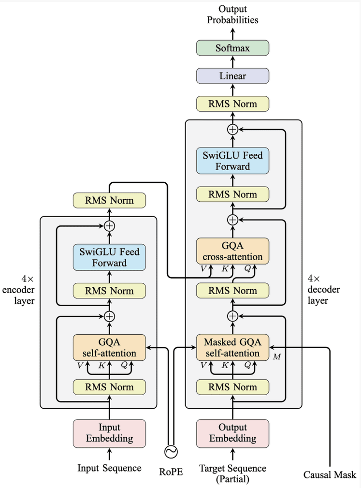
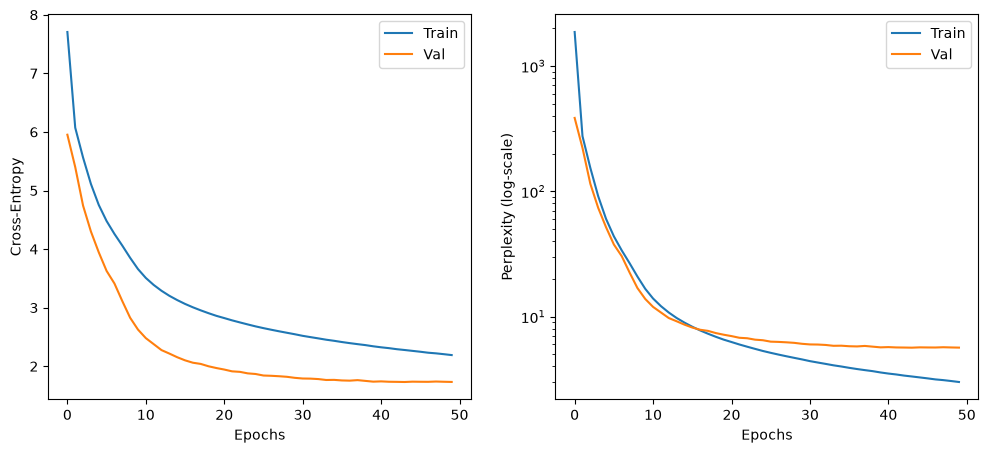
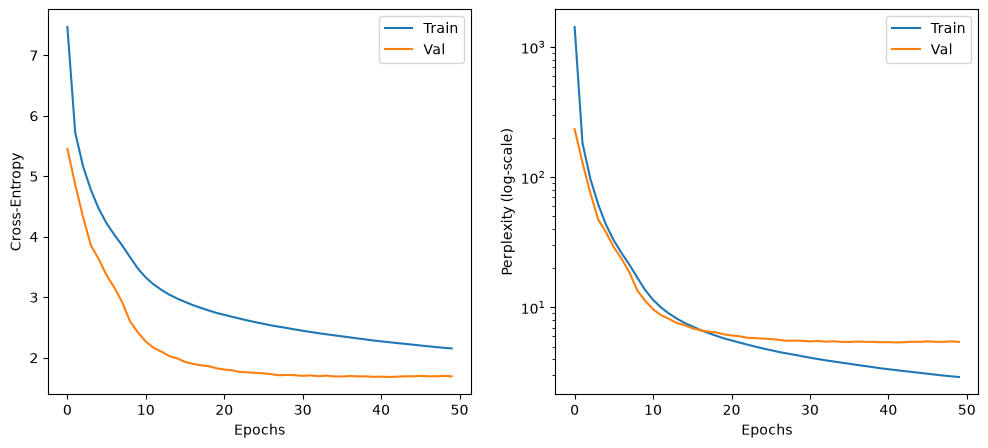

# Neural Machine Translation (NeuralMT)

* PyTorch implementation of an encoder-decoder Transformer [1]
* Byte-pair encoding (BPE) tokenizer implemented from scratch
* Multi-head attention (MHA) [1] and rotary positional embeddings (RoPE) [2]
* Achieved BLEU scores of 34.11 (en2de) and 34.73 (de2en) (Multi30k) [3]

## Architecture

Transformer architecture used in this repository:

<p align="center">
  
</p>

<p align="center">
  <em>
    Figure 1: Transformer architecture used in this repository, adapted from
    <a href="https://machinelearningmastery.com/building-a-transformer-model-for-language-translation/">Brownlee</a>.
  </em>
</p>

**NOTE:** Figure 1 shows 4 layers and grouped-query attention (GQA), while the implementation in this repo uses 6 encoder-decoder layers and multi-head attention (MHA).

## Usage

The Multi30k German-Englisch Machine Translation dataset can be downloaded here:

[Multi30k](https://huggingface.co/datasets/bentrevett/multi30k)

#### Inference

Download the tokenizer file from:

[tokenizer_de_en_vocab8k.pickle](https://github.com/raphaelsenn/neuralMT/releases/tag/v1.0.0)

Download the pretrained NMT model weights from:

[nmt_en2de_48.2M_vocab8k.pt](https://github.com/raphaelsenn/neuralMT/releases/tag/v1.0.0)

```python
import torch

from neuralmt import BPETokenizer
from neuralmt import NeuralMachineTranslator

# Load tokenizer
TOKENIZER_FILE = "tokenizer_de_en_vocab8k.pickle"
tokenizer = BPETokenizer.load(TOKENIZER_FILE)
bos_id = tokenizer.bos_id
eos_id = tokenizer.eod_id
pad_id = tokenizer.pad_id

# Load neural machine translation model
NMT_WEIGHTS_FILE = "nmt_en2de_48.2M_vocab8k.pt"
nmt = torch.load(model_file, map_location="cpu", weights_only=False)
nmt.eval()

# Inference
src = "Leute, die vor einem Gebäude stehen."                # string
tokens_src = tokenizer.encode(source)                       # list of n ints
tokens_src = torch.as_tensor(tokens, dtype=torch.int64)     # tensor of shape [n]
tokens_src = tokens_source.unsqueeze(0)                     # tensor of shape [1, n]

tokens_tgt = nmt.generate(tokens_src)                       # tensor of shape [1, generated_length]
tokens_tgt = tokens_tgt.squeeze(0)                          # tensor of shape [generated_length]
tokens_tgt = tokens_tgt.detach().tolist()                   # list of generated_length ints
tgt = tokenizer.decode(tokens_tgt.detach().tolist(), True)  # string

print(tgt)  # "People standing in front of a building."
```

#### Training

##### 1. Train Byte Pair Encoding Tokenizer:

```bash
python3 train_bpe.py
```

##### 2. Train the Transformer Model:

```bash
python3 train.py
```

## Evaluation

<p align="center">
  
</p>

<p align="center"> <em>Figure 1: Training, validation loss (left) and perplexity (right) on Multi30k english-to-german task.</em> </p>


<p align="center">
  
</p>

<p align="center"> <em>Figure 2: Training, validation loss (left) and perplexity (right) on Multi30k german-to-english task.</em> </p>


| Task | Parameters | Perplexity | BLEU |
|---|---:|---:|---:|
| English to German | 48.2M | 5.6939 | 34.1119 |
| German to English | 48.2M | 5.4320 | 34.7348 |

<p align="center"> <em>Table 1: Performence on Multi30k test set.</em> </p>


## Citations

```bibtex
@misc{su2023roformerenhancedtransformerrotary,
      title={RoFormer: Enhanced Transformer with Rotary Position Embedding}, 
      author={Jianlin Su and Yu Lu and Shengfeng Pan and Ahmed Murtadha and Bo Wen and Yunfeng Liu},
      year={2023},
      eprint={2104.09864},
      archivePrefix={arXiv},
      primaryClass={cs.CL},
      url={https://arxiv.org/abs/2104.09864}, 
}

@misc{vaswani2023attentionneed,
      title={Attention Is All You Need}, 
      author={Ashish Vaswani and Noam Shazeer and Niki Parmar and Jakob Uszkoreit and Llion Jones and Aidan N. Gomez and Lukasz Kaiser and Illia Polosukhin},
      year={2023},
      eprint={1706.03762},
      archivePrefix={arXiv},
      primaryClass={cs.CL},
      url={https://arxiv.org/abs/1706.03762}, 
}

@article{elliott-EtAl:2016:VL16,
 author    = {{Elliott}, D. and {Frank}, S. and {Sima'an}, K. and {Specia}, L.},
 title     = {Multi30K: Multilingual English-German Image Descriptions},
 booktitle = {Proceedings of the 5th Workshop on Vision and Language},
 year      = {2016},
 pages     = {70--74},
 year      = 2016
}
```
